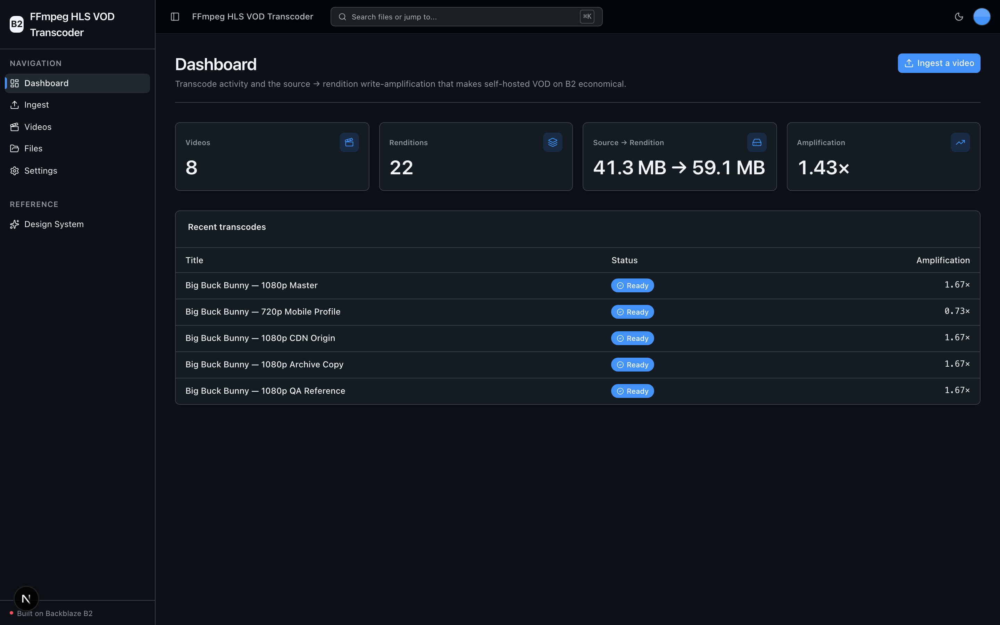
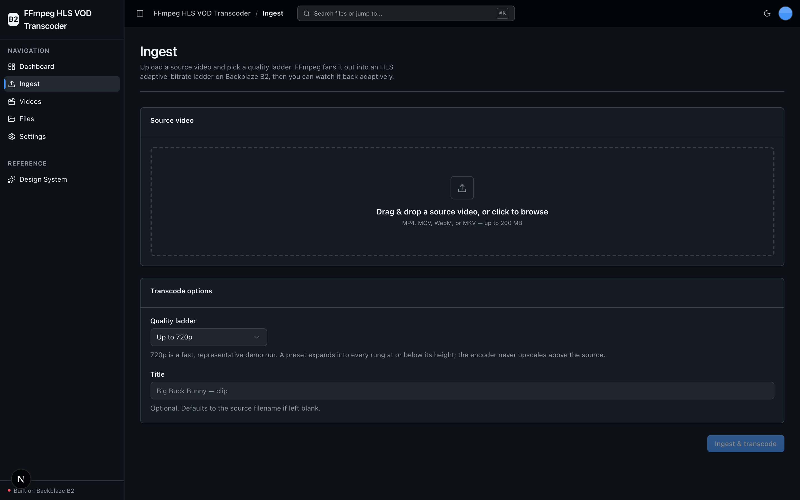
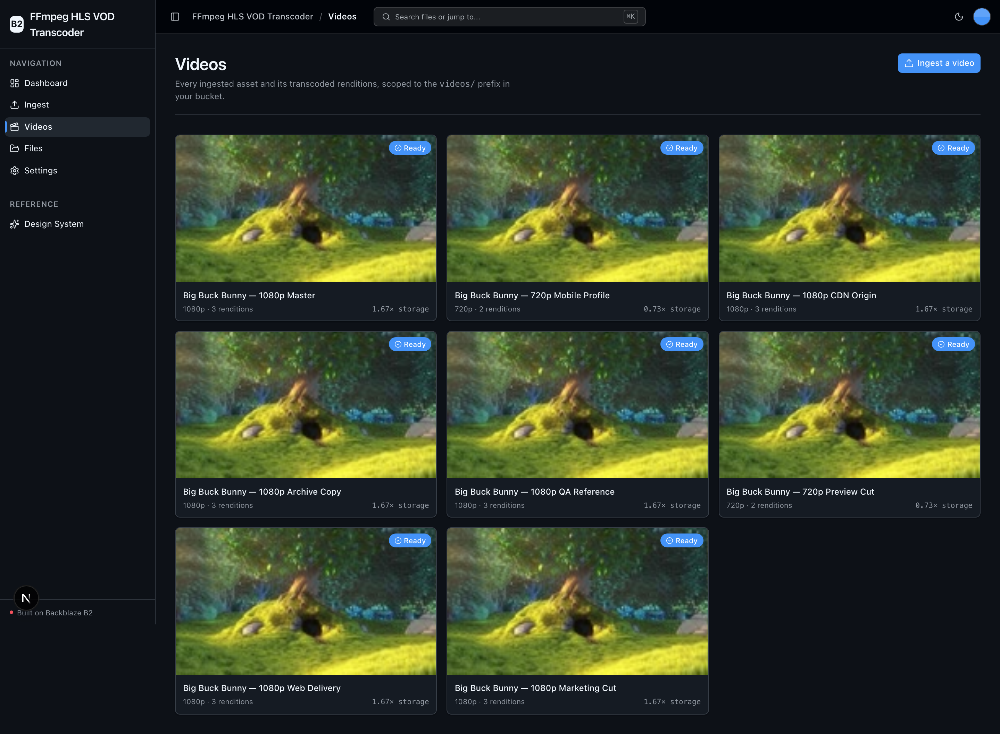
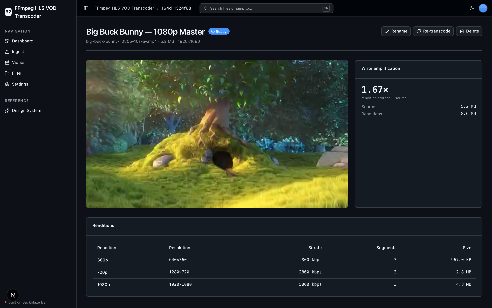

<!-- last_verified: 2026-07-31 -->
# FFmpeg HLS VOD Transcoder

A self-hosted **video-on-demand (VOD) transcoding pipeline** backed by **[Backblaze B2](https://www.backblaze.com/cloud-storage?utm_source=github&utm_medium=referral&utm_campaign=ai_artifacts&utm_content=b2ai-ffmpeg-hls-vod-transcoder)** — a Mux / Cloudflare-Stream-style workflow at B2 storage costs. Upload one source video; the app runs **FFmpeg locally** to fan it out into a multi-bitrate **HLS adaptive-bitrate ladder** (360p / 720p / 1080p) plus a thumbnail sprite, writes every rendition segment, playlist, master manifest, and sprite **back to B2 per-video**, and streams the result adaptively in the browser via **hls.js** through a thin API proxy.

**Why B2 is the star: write amplification.** One source upload becomes 3–5× storage in derived renditions, and B2's cheap object storage is what makes self-hosted VOD economical. The dashboard surfaces that source → rendition amplification factor as the headline metric.

**What you get out of the box:**
- Source ingest to B2 with container + magic-byte validation
- Local FFmpeg HLS ladder transcode (CPU `libx264` default; optional hardware-encoder autodetect, never GPU-required)
- Thumbnail sprite sheet + WebVTT thumbnail track — the standard HLS scrub-preview artifacts, ready for scrub-preview-capable / CDN players; the bundled hls.js demo player uses `sprite.jpg` as its poster frame
- Adaptive playback (hls.js, with native-HLS Safari fallback) via an API HLS proxy that streams straight from B2
- Full video lifecycle: library, detail/play, rename, re-transcode, delete (prefix-scoped)
- A full-bucket File Browser so you can see the fanned-out rendition objects directly
- FastAPI backend with a strict layered architecture and structural tests, plus agent-optimized docs

> **FFmpeg is bundled.** The binary comes from the `imageio-ffmpeg` Python package (a static build that includes `libx264` + AAC), so a fresh clone transcodes with **no** system `brew/apt install ffmpeg`. Set `FFMPEG_BINARY` to point at another build if you prefer.

## What it looks like

**Dashboard** — transcode fleet metrics (videos, renditions, source → rendition bytes, and the headline write-amplification factor) with a recent-transcodes table.



**Ingest** — drag-and-drop a source video, pick an HLS quality ladder, and queue a local FFmpeg transcode to B2.



**Videos** — the asset library grid scoped to the `videos/` prefix, each card showing its ladder, rendition count, and storage amplification.



**Video detail** — adaptive hls.js playback with the per-video write-amplification breakdown and the full HLS rendition ladder.



## How it works

```
        ┌──────── Ingest ────────┐      ┌──── Transcode (local FFmpeg) ────┐      ┌──── Playback ────┐
source →│ POST /videos → temp →  │ B2 → │ probe → HLS ladder + sprite →    │ B2 → │ hls.js ← API HLS │
video   │ videos/{id}/source.ext │      │ upload renditions → manifest ready│      │ proxy ← segments │
        └────────────────────────┘      └──────────────────────────────────┘      └──────────────────┘
```

Transcoding runs as a background job: `POST /videos` uploads the source and writes an `asset.json` manifest with `status: "transcoding"`, then a FastAPI `BackgroundTasks` worker transcodes, uploads renditions, and flips the manifest to `"ready"` (or `"failed"` + error). The frontend polls `GET /videos/{id}` until terminal.

### Per-video B2 layout

The proxy maps request paths to B2 keys 1:1, so HLS relative segment references resolve with no playlist rewriting:

```
videos/{id}/source.<ext>
videos/{id}/asset.json               # manifest: title, status, source_size, renditions[], amplification…
videos/{id}/hls/master.m3u8
videos/{id}/hls/{360p,720p,1080p}/index.m3u8
videos/{id}/hls/{360p,720p,1080p}/seg_00001.ts …
videos/{id}/thumbs/sprite.jpg
videos/{id}/thumbs/sprite.vtt
```

## Agent-First Architecture

This repo is optimized for coding agents. The structure follows the principle that **repository knowledge is the system of record** — everything an agent needs to reason about the codebase is versioned, co-located, and discoverable from the repo itself.

**[AGENTS.md](AGENTS.md) is the single source of truth for all coding agents.** Agent-specific files (CLAUDE.md, GEMINI.md, Copilot instructions) are thin pointers back to it. Architecture is enforced mechanically — layering rules, import boundaries, file-size limits, and SDK/subprocess containment are verified by structural tests and lints on every change.

```
AGENTS.md              Single source of truth — layout, invariants, commands, conventions
ARCHITECTURE.md        System layout, layering rules, data flows
docs/
  features/            Feature docs (inputs, outputs, flows, edge cases)
  app-workflows.md     User journeys
  dev-workflows.md     Engineering workflows and testing
  SECURITY.md          Security principles
  RELIABILITY.md       Reliability expectations
  exec-plans/          Execution plans and tech debt tracker
```

| Principle | Implementation |
|-----------|---------------|
| Strict layered architecture | `types -> config -> repo -> service -> runtime`, enforced by tests |
| Contain external tools | `boto3` **and** the FFmpeg subprocess live only in `repo/` — verified by structural tests |
| Keep files agent-sized | 300-line limit per file, enforced by test |
| Docs updated with code | Same-PR requirement prevents documentation rot |
| Structured observability | JSON logging, `/metrics` endpoint, request tracing |

## Quick Start

You need: Node.js >= 20, pnpm >= 9, Python >= 3.11, and a free **[Backblaze B2 account](https://www.backblaze.com/cloud-storage?utm_source=github&utm_medium=referral&utm_campaign=ai_artifacts&utm_content=b2ai-ffmpeg-hls-vod-transcoder)**. FFmpeg is bundled (see the note above) — you do **not** need to install it separately.

Local scripts are supported on macOS, Linux, and WSL2. Native Windows is not supported (the dev scripts use POSIX shell and `services/api/.venv/bin/*` paths); use WSL2.

### Setup

**1. Run setup**

```bash
pnpm run setup
```

This copies `.env.example` to `.env` (only if missing), installs workspace dependencies from `pnpm-lock.yaml`, creates `services/api/.venv` if missing, and installs the API's committed Python 3.11 resolution from `services/api/requirements.lock` (including `imageio-ffmpeg`). It is safe to rerun.

> Use the `pnpm run` form: `setup` (like `doctor`) is a built-in pnpm command before pnpm 11, so bare `pnpm setup` would run pnpm's own command instead of this script.

**2. Add your B2 credentials**

Open `.env` and, from the [Backblaze B2 dashboard](https://secure.backblaze.com/b2_buckets.htm?utm_source=github&utm_medium=referral&utm_campaign=ai_artifacts&utm_content=b2ai-ffmpeg-hls-vod-transcoder):

1. **Create a bucket** and paste its values:
   - **Bucket Unique Name** → `B2_BUCKET_NAME`
   - The **region** in the endpoint (`s3.<region>.backblazeb2.com`) → `B2_REGION` (e.g. `us-east-005`)
2. **Create an application key** with `Read and Write` permission:
   - **keyID** → `B2_APPLICATION_KEY_ID`
   - **applicationKey** → `B2_APPLICATION_KEY` *(only shown once — paste it now)*

**Standard B2 environment variables**

| Variable | Required | Purpose |
|----------|----------|---------|
| `B2_APPLICATION_KEY_ID` | yes | B2 application key ID |
| `B2_APPLICATION_KEY` | yes | B2 application key secret |
| `B2_BUCKET_NAME` | yes | Target bucket (all app data lives under the `videos/` prefix) |
| `B2_REGION` | no (default `us-east-005`) | Drives the S3 endpoint `https://s3.<region>.backblazeb2.com` — no region string is hardcoded in source |
| `B2_PUBLIC_URL_BASE` | no | Public bucket/CDN base for building public object URLs. Playback is API-proxied, so the app runs fine without it |

**3. Run it**

```bash
pnpm dev
```

Frontend at `localhost:3000`, API at `localhost:8000`. Head to **Ingest**, drop in a short MP4/MOV/WebM/MKV clip, pick a ladder, and watch it transcode and play back. Interactive API docs (Swagger UI) are at `localhost:8000/docs`.

`pnpm dev` runs a preflight check first (`pnpm run doctor`) — it catches wrong Node/Python versions, a missing venv, a missing/placeholder `.env`, or taken ports.

## Write amplification — why B2

Adaptive streaming means storing the **same content several times over**: a single source becomes a 360p, 720p, and 1080p rendition, each chopped into `.ts` segments, plus playlists, a master manifest, and a sprite sheet. A typical H.264 ladder lands around **3–5× the source size** in derived objects. Managed services bill that fan-out at a premium; on B2's object storage it costs a fraction, which is exactly what makes self-hosting VOD viable. The app measures the ratio per video (`amplification_factor = rendition_bytes / source_bytes`) and fleet-wide on the dashboard. See [docs/features/transcode-pipeline.md](docs/features/transcode-pipeline.md) for the economics and a DASH-extension note.

## Core Features

- [Video Ingest](docs/features/video-ingest.md) — drag-and-drop a source video, pick a ladder, queue transcoding
- [Transcode Pipeline](docs/features/transcode-pipeline.md) — FFmpeg HLS ladder + sprite + write-amplification economics
- [Video Library](docs/features/video-library.md) — scoped asset explorer + detail/play + rename / re-transcode / delete
- [File Browser](docs/features/file-browser.md) — full-bucket list, preview, download, delete (see the rendition objects)
- [Dashboard](docs/features/dashboard.md) — transcode metrics: videos, renditions, source vs rendition bytes, amplification
- [Metadata Extraction](docs/features/metadata-extraction.md) — image dimensions, EXIF, PDF info, checksums (Files browser)
- [Design System](docs/design-system.md) — tokens, primitives, error/empty states. Live at `/design`.

Plus: single-source `.env` config validated at startup, a centralized TanStack Query data layer, a checked API contract (`pnpm contract:check`), structural tests, JSON logging, `/health` + `/metrics`, per-IP rate limiting, and magic-byte source validation ([SECURITY.md](docs/SECURITY.md)).

## Tech Stack

- TypeScript, Next.js 16, React 19, Tailwind v4, shadcn/ui, **hls.js**
- TanStack Query — caching, dedup, retry for every fetch
- Python 3.11+, FastAPI, boto3, Pydantic v2, **imageio-ffmpeg** (bundled FFmpeg), Pillow, PyPDF2
- Backblaze B2 (S3-compatible object storage)
- pnpm workspaces (monorepo)

## Commands

| Command | What it does |
|---------|-------------|
| `pnpm run setup` | Idempotently copy `.env.example` to `.env` if missing, install deps, create the backend venv, install locked API deps |
| `pnpm run doctor` | Preflight environment check (also runs before `pnpm dev`) |
| `pnpm dev` | Start frontend + backend |
| `pnpm dev:web` / `pnpm dev:api` | Frontend / backend only |
| `pnpm contract:export` | Export deterministic FastAPI OpenAPI JSON to `docs/api/openapi.json` |
| `pnpm contract:check` | Verify the OpenAPI artifact and frontend API client route registry |
| `pnpm check:agent-docs` | Validate agent shims, command docs, CI claims, and `.env` ignore coverage |
| `pnpm verify` | Credential-free pre-PR suite — `check:agent-docs`, then `verify:api`, then `verify:web` |
| `pnpm verify:api` | Backend half: API lint, API tests, structure tests |
| `pnpm verify:web` | Frontend half: web lint, web unit tests, web typecheck + build |
| `pnpm verify:full` | `doctor`, then `verify`, then Playwright E2E; requires a populated `.env`, local server/browser permission, port 3000 free, and Chromium installed |
| `pnpm build` / `pnpm lint` | Build / lint frontend |
| `pnpm lint:api` / `pnpm test:api` | Lint / test backend |
| `pnpm check:structure` | Verify layering rules |
| `pnpm test:e2e` | Playwright E2E (run `pnpm --filter @ffmpeg-hls-vod-transcoder/web exec playwright install chromium` once first) |

Run `pnpm verify` before opening a PR; it needs `services/api/.venv` from setup and neither B2 credentials nor a browser. If you add a Node dependency, run `pnpm install`; for an API dependency, follow the reviewed refresh workflow in [docs/dev-workflows.md](docs/dev-workflows.md#python-dependency-updates).

## Documentation Map

| Doc | Purpose |
|-----|---------|
| [AGENTS.md](AGENTS.md) | Agent table of contents — start here |
| [ARCHITECTURE.md](ARCHITECTURE.md) | System layout, layering, data flows |
| [docs/features/](docs/features/) | Feature docs (ingest, transcode pipeline, library, browser, dashboard, metadata) |
| [docs/design-system.md](docs/design-system.md) | Design tokens, primitives, error/empty states |
| [docs/app-workflows.md](docs/app-workflows.md) | User journeys |
| [docs/dev-workflows.md](docs/dev-workflows.md) | Engineering workflows and testing |
| [docs/SECURITY.md](docs/SECURITY.md) | Security principles |
| [docs/RELIABILITY.md](docs/RELIABILITY.md) | Reliability expectations |
| [docs/exec-plans/](docs/exec-plans/) | Execution plans and tech debt tracker |

## Contributing

Start with [AGENTS.md](AGENTS.md). It's the map — everything else is discoverable from there. For local commit hooks, follow [the pre-commit workflow](docs/dev-workflows.md#pre-commit).

## License

MIT License - see [LICENSE](LICENSE) for details.

## Claude Agent B2 Skill

Manage Backblaze B2 from your terminal using natural language (list/search, audits, stale or large file detection, security checks, safe cleanup).

Repo: [https://github.com/backblaze-b2-samples/claude-skill-b2-cloud-storage](https://github.com/backblaze-b2-samples/claude-skill-b2-cloud-storage)
